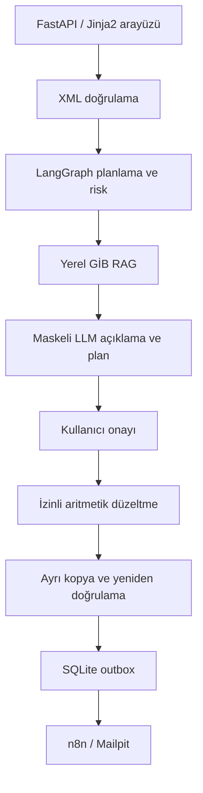

# FaturaGuard AI

UBL-TR e-Fatura XML belgelerini doğrulayan, bulguları resmî GİB kaynaklarıyla
açıklayan ve kullanıcı onayıyla sınırlı aritmetik düzeltmeler uygulayan bootcamp projesi.
Orijinal dosya korunur. Elektronik imza üretimi ve GİB'e gönderim yapılmaz.


## Projede neler var?

- XML/XSD/Schematron ve aritmetik doğrulama (`efatura-kontrol`).
- Yerel E5/Chroma + BM25 araması ve ağırlıklı rerank ile resmî kaynaklı RAG.
- LangGraph üzerinde görev planlama, koşullu akış, izinli araçlar ve insan onayı.
- Gemini/Groq ile maskeli açıklama, düzeltme planı ve belgeye bağlı sohbet.
- Dört dip toplam alanı için lxml/Decimal düzeltme, diff ve yeniden doğrulama.
- SQLite işlem geçmişi ve audit; n8n'e kalıcı kuyrukla teslim ve yerel Mailpit bildirimi.

## Hızlı başlangıç: temiz Git klonu

Python 3.11 veya üzeri gerekir. Test edilmiş sabit Windows kurulumu Python 3.14'tür.
İlk kurulumda Python paketleri, resmî dokümanlar ve açık embedding modeli için
internet ve disk alanı gerekir. Büyük kaynaklar, model, indeks, kişisel belgeler,
API anahtarları ve SQLite veritabanı Git'te tutulmaz.

```cmd
git clone https://github.com/Muhammed-Cosgun/FaturaGuard-AI.git
cd FaturaGuard-AI
```

Repo private ise GitHub erişim izni gerekir. Öğretmene repo bağlantısı göndermek
tek başına erişim vermez; hesabı collaborator olarak eklenmelidir.

### Windows / Python 3.14

```cmd
KUR.cmd
.venv-clean\Scripts\python.exe scripts\prepare_demo.py --download-sources --download-model
BASLAT.cmd
```

KUR.cmd sürüm kontrolü yapar ve `requirements-windows-py314.lock.txt` ile kurar.
Hazırlık komutu örnek XML'leri üretir, eksik resmî dosyaları izinli HTTPS
adreslerinden indirip kayıtlı SHA-256 ile doğrular, sabit sürümlü embedding
modelini indirir ve RAG/Chroma indeksini oluşturur. **LLM çağırmaz.**
Kaynak değişmişse hash'i kendiliğinden güncellemez; güvenli biçimde durur.

Site: <http://127.0.0.1:8011> · sağlık kontrolü: <http://127.0.0.1:8011/health>.
Örnek dosyalar hazırlıktan sonra `data/demo-fixtures/` dizinindedir.

### Linux/macOS veya farklı Python sürümü

```bash
python -m venv .venv
# Linux/macOS:
source .venv/bin/activate
# Windows PowerShell alternatifi: .\.venv\Scripts\Activate.ps1
python -m pip install -e ".[dev]"
python scripts/prepare_demo.py --download-sources --download-model
python -m uvicorn faturaguard.main:app --host 127.0.0.1 --port 8011
```

Windows kilit dosyası diğer işletim sistemleri için kullanılmaz. Genel kurulum
pyproject.toml aralıklarını çözer; bire bir Windows paket listesiyle aynı değildir.
Komutları proje kökünden çalıştırın. Dağıtım wheel'i uygulama kodunu ve web
varlıklarını içerir; kurulum betikleri/test verileri için Git klonunu kullanın.

### RAG veya API olmadan inceleme

```bash
python scripts/prepare_demo.py --fixtures-only
python -m uvicorn faturaguard.main:app --host 127.0.0.1 --port 8011
```

Bu seçenek örnek XML üretir, ağ/LLM kullanmaz. RAG varlıkları yokken temel XML
analizi ve raporlama açılır; kaynaklı AI sohbeti ve onaya hazır AI düzeltme
planının çalıştığı iddia edilmez. Tam demo için hazırlık adımını tamamlayın.

## Model bağlantısı ve gizlilik

Uygulama `.env` dosyasını otomatik yüklemez. [.env.example](.env.example) yalnızca
ayar adlarını gösterir. Kendi terminalinizde veya kullanıcı ortamınızda
`GEMINI_API_KEY` ve/veya `GROQ_API_KEY` tanımlayın; yeni terminalden başlatın.
Anahtarları README'ye, Git'e, ekran görüntüsüne veya sohbete yazmayın.

- Güncel API zinciri: Gemini, ardından Groq, açıklamada deterministik kaynak özeti.
- Kullanıcılar kendi ücretsiz plan/kotalarını kontrol eder. Uygulama ücretli
  abonelik başlatmaz; hesap faturalamasını veya ücretsiz kotanın sürekliliğini garanti edemez.
- Uzak API istemeyenler için açıklama katmanında `LLM_PROVIDER=local`, Ollama ve
  `gemma3:4b` seçeneği vardır. Yeni sohbet hattı Gemini/Groq olmadığında yerel
  kayıt özeti verir; tam yerel LLM sohbeti kurulmuş değildir.
- Ham XML dosyası API'ye gönderilmez. Sorunun, son altı soru-cevabın ve gereken
  belge bağlamının maskeli hâli sohbet sağlayıcısına gidebilir. Maskeleme her
  özel bilgiyi yakalayamayabilir. Kaynak kartı, sağlayıcı etiketi ve yerel yedek ayrımı görünür.

## Örnek demo

1. `data/demo-fixtures/demo_tax_exclusive_error.xml` yükleyin.
2. Beklenen ilk sonuç: 0 hata, 2 uyarı, 1 bilgi.
3. Kaynaklı plan hazırsa `TaxExclusiveAmount` için 15.00 → 15.15 teklifini inceleyin ve onaylayın.
4. Yeni sonuç: 0 hata, 0 uyarı, 1 bilgi. Orijinal korunur, ayrı kopya düzeltilir.
5. Sohbete “Düzeltmeden sonra ne değişti?” sorun; üretici ve dayanakları inceleyin.
6. n8n açıksa yeni işlemin mesajını yerel Mailpit'te görün.

Kalan `imza-yok` bilgi kaydı, belgeye imza atıldığı anlamına gelmez.
Ayrıntı: [demo senaryosu](DEMO_SCENARIO.md).

## n8n otomasyonu (isteğe bağlı)

Docker Desktop/Engine ve Compose gerekir. n8n Community ve Mailpit yerelde
çalışır; bu workflow AI modeli çağırmaz veya dışarı e-posta göndermez.

```cmd
.venv-clean\Scripts\python.exe scripts\setup_local_automation.py
docker compose -f n8n\compose.yaml up -d
```

[n8n kurulum rehberini](n8n/KURULUM.md) izleyerek workflow'u içe aktarın,
Header Auth ve yerel SMTP credential'larını seçin ve yayınlayın.
`OTOMASYON_CALLBACK.cmd` ve `OTOMASYON_SITE.cmd` ayrı terminallerde açık kalmalıdır.
Normal `BASLAT.cmd` yerel otomasyon ayar dosyasını yüklemez.

- n8n: <http://localhost:5678>
- Yerel posta kutusu: <http://localhost:8025>
- Kuyruk/inceleme durumu: `python scripts/automation_status.py`
- Canlı sentetik kabul: `python scripts/run_automation_acceptance.py`

Tekil olay/inceleme, tamamlanma cevabı ve sınırlı retry vardır. SMTP gönderiminden
sonra kayıt öncesi çökmede e-posta yinelenebilir; exactly-once garantisi yoktur.
Durdurma `docker compose -f n8n/compose.yaml stop`; volume silmek gerekmez.

## Testler ve değerlendirme

```bash
python -m pytest -p no:cacheprovider -o addopts="" -q --basetemp=.pytest-work-check
python -m ruff check .
python -m pip check
python scripts/check_submission.py --history
python scripts/run_document_chat_quality_evaluation.py
# RAG varlıkları hazırsa; yalnızca yerel embedding/retrieval:
python scripts/evaluate_rag.py
# API çağırmaz; dosya/ayar varlığını kontrol eder:
python scripts/run_demo_preflight.py
```

Normal pytest/CI gerçek sağlayıcı anahtarı veya n8n istemez. `*_smoke_test.py`,
`run_web_acceptance.py` ve API benchmark'ları ayrı canlı testlerdir; gerçek
LLM/kota kullanabilir. Bunları otomatik kalite testiyle karıştırmayın.

Kapanış kontrolünde 518 test ve 24 yerel yanıt kalite vakası geçmişti.
Teslim için ek kurulum/güvenlik kontrollerinin güncel sonucu
[TESLIM_KONTROLU.md](TESLIM_KONTROLU.md) içinde tutulur.
11 golden sorguda hibrit Recall@3=0.9091, MRR@3=0.7121; semantic
Recall@3=0.8182, MRR@3=0.7576. Hibrit her ölçütte üstün değildir. Bu ölçümler
retrieval'ı değerlendirir, bütün AI yanıtlarının doğruluğunu kanıtlamaz.
Çalışma zamanı raporları `data/evaluation/` altında üretilir, Git'te değildir.

## Mimari



Rerank ayrı neural model değildir: 0.55 semantic + 0.30 normalize BM25 +
0.15 teknik terim eşleşmesi. Embedding modeli `intfloat/multilingual-e5-small`,
revizyonu kodda sabittir. Kaynaklar [GİB envanterinden](resources/gib/official_sources.json)
SHA-256 ile doğrulanır.

## Belgeler ve sunum

- [Gereksinimler ve kapsam](SRS.md)
- [Mimari ve AI güvenliği](Architecture_and_AI_Safety.md)
- [Geliştirme planı](Project_Plan.md)
- [Test ve teslim özeti](Test_and_Delivery_Report.md)
- [Son prototip kontrolü](SON_KONTROL_RAPORU.md)
- [GitHub teslim kontrolü](TESLIM_KONTROLU.md)
- [PowerPoint sunumu](sunum/FaturaGuard_AI_Sunum.pptx)
- [Konuşma ve demo planı](SUNUM_HAZIRLIK.md)
- [Ekran görüntülerinin kaynakları](sunum/gorseller/KAYNAKLAR.md)
- [Üçüncü taraf bileşenler](THIRD_PARTY_NOTICES.md)
- [Güvenlik taraması ve bilinen sınırlar](SECURITY.md)

## Sınırlar

Düzeltme yalnızca dört dip toplam alanını kapsar; tüm GİB hata senaryolarını
otomatik gidermez. MCP, e-imza/mali mühür, GİB gönderimi ve üretim ölçeğinde
çok kullanıcılı kimlik/yetki sistemi uygulanmadı. Yerel eğitim/demo amacıyla
çalıştırın. n8n callback'i tokenlıdır; bu durum ana siteyi internete açmak için
üretim güvenliği sağlandığı anlamına gelmez. Gerçek fatura veya sır içeren
çalışma verilerini repoya eklemeyin.
